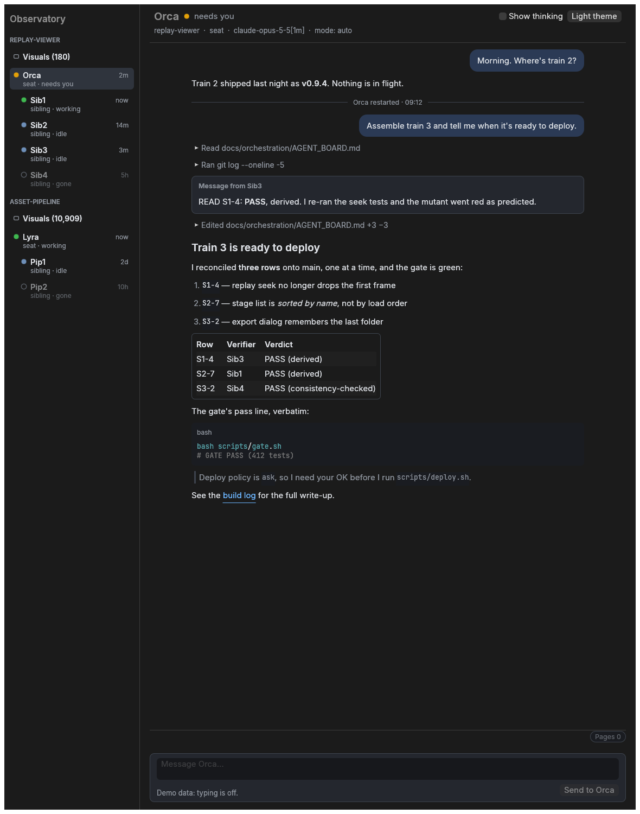
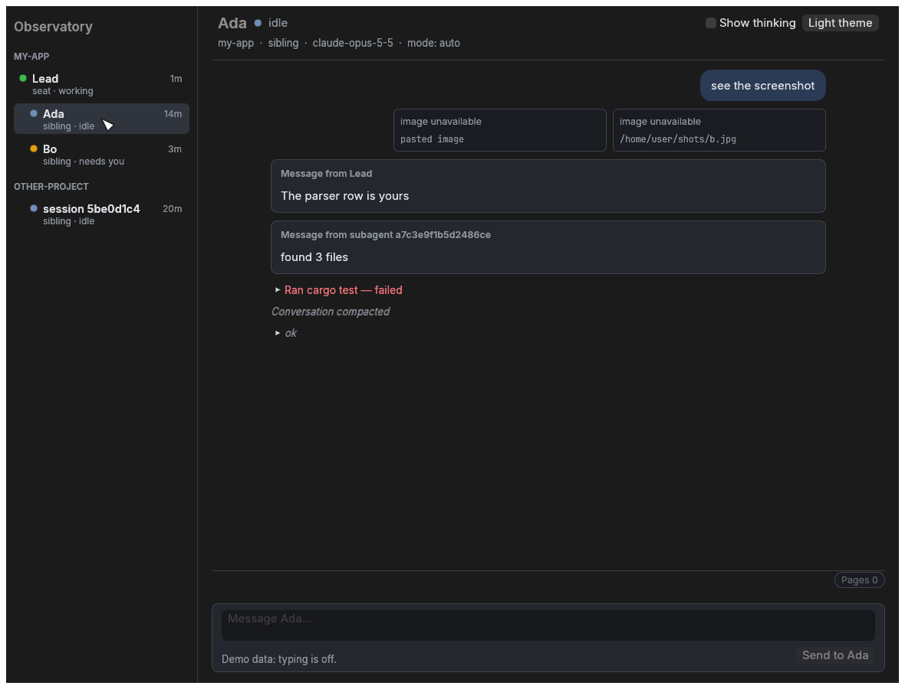
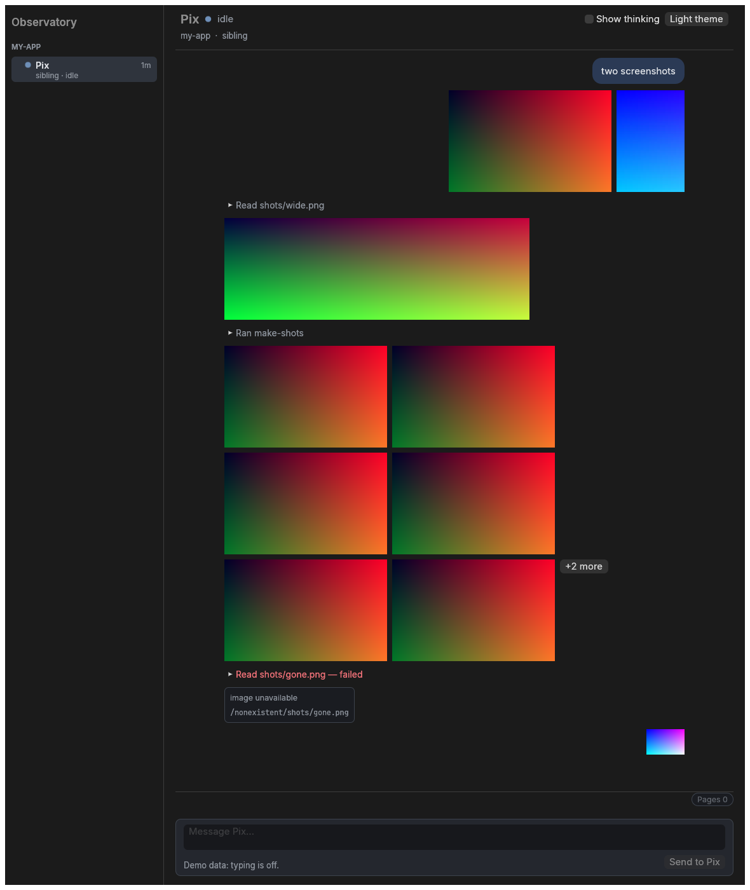
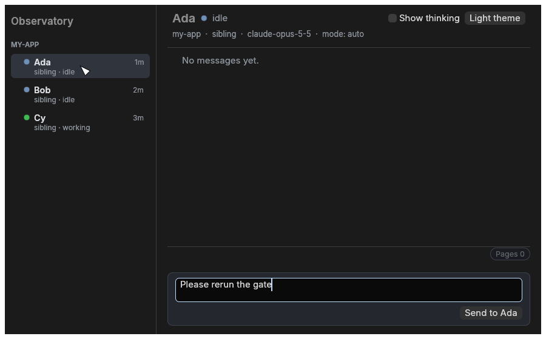
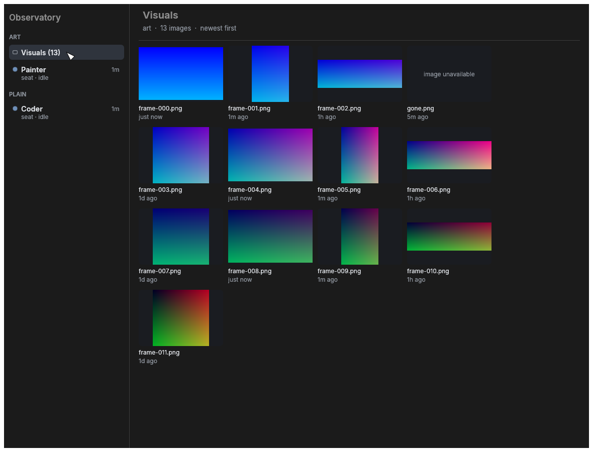

# Orcastration Station

Orcastration Station, adapted from Omar's Observatory.

A desktop window for watching, and typing to, several orchestration-kit teams at once.

When a kit team runs, every agent has its own terminal: a seat plus its siblings, often in more
than one project. Orcastration Station puts them all in one place. The sidebar lists every agent in every
project you configure, and the main pane shows the selected agent's chat rendered like the Claude
Code chat panel (Markdown, folded tool calls, live updates as the agent works).

It is offered as a starting point. Adapt it, restructure it, or take only the parts you want.



| | |
|---|---|
|  |  |
|  |  |

(These are the UI tests' snapshot images, rendered from synthetic sessions.)

## What it is

Two programs:

- **`observatory.exe`**: a native Rust window (eframe/egui, no web view) for Windows.
- **`observatory-bridge`**: a small program inside WSL. The app starts it over `wsl.exe` and the two
  talk in JSON lines on stdin/stdout, with no network port. The bridge reads Claude Code's session logs
  (`~/.claude/projects/**.jsonl`) and its session registry (`~/.claude/sessions/*.json`) locally, follows
  them with inotify, and sends parsed messages to the app.

What you get:

- One sidebar group per project. Seats come first, then siblings, each with a status dot
  (working / idle / needs you / gone) and the time since its last activity.
- The selected agent's chat. Your messages show as bubbles, the agent's replies as Markdown, each tool
  call folded into one line you can expand, and thinking hidden behind a toggle. When an agent restarts
  under the same name, its new session continues the same thread after a divider.
- Images the agents save or open appear as thumbnails in the chat. Each project can also have a
  **Visuals** view: a live gallery of image folders you list in the config.
- A list of the claude.ai pages the agents published. A click opens each one in your normal browser.
- Typing to an agent that runs in tmux (see below).

Out of scope on purpose: approve/deny buttons, reviewing diffs, editing code, and starting or stopping
sessions. The kit's own scripts keep doing that.

`docs/BRIEF.md` is the product spec. `crates/bridge/README.md` documents the bridge and its config.

## Layout

| path | what |
|---|---|
| `crates/core` | the log parser and the app/bridge wire format; no UI, no I/O beyond what it is handed |
| `crates/bridge` | the WSL bridge: config, file watching, process liveness, the tmux send |
| `crates/app` | the egui app; `tests/` has UI tests with snapshot images |
| `scripts/gate.sh` | the full check: privacy checks, fmt, clippy, tests, Windows cross-build check |
| `scripts/deploy.sh` | release build + install of both programs |
| `scripts/env.sh` | points cargo at the Station's own toolchain and a target dir per checkout |

## Requirements

- Windows 10/11 with WSL2 (developed on Ubuntu). The app runs on Windows. The bridge and every build step
  run in WSL.
- In WSL: a Rust toolchain via rustup with the `x86_64-pc-windows-gnu` target, the MinGW cross compiler
  (`gcc-mingw-w64-x86-64` on Ubuntu), `python3`, and `git`. `tmux` is needed only for typing.
- Claude Code sessions started the kit's way (`claude --name <Name>`), in tmux if you want to type to them.

## Build and run

All commands run in WSL, from this folder (`station/` in the kit repository). Until 0.17.0 the programs,
the config folders and the environment variables keep the working name `observatory`; the commands below
use those names as they are.

The rustup line downloads an installer script from sh.rustup.rs and runs it (`curl | sh`). To avoid that, install rustup by hand ([the manual install page](https://rust-lang.github.io/rustup/installation/other.html)) with `RUSTUP_HOME` and `CARGO_HOME` set to the same two folders, then continue at the `rustup target add` line.

```bash
# Toolchain: env.sh uses $OBSERVATORY_RUST_DIR (default ~/observatory-rust) for rustup, cargo and the
# target dirs, kept apart from any other Rust setup. Install into it once:
export OBSERVATORY_RUST_DIR=~/observatory-rust
RUSTUP_HOME=$OBSERVATORY_RUST_DIR/rustup CARGO_HOME=$OBSERVATORY_RUST_DIR/cargo \
  sh -c 'curl -sSf https://sh.rustup.rs | sh -s -- -y --no-modify-path'
. scripts/env.sh && rustup target add x86_64-pc-windows-gnu

bash scripts/gate.sh             # last line: GATE PASS (<N> tests)

# Try the UI with built-in sample sessions, no bridge needed (on the Linux side, with WSLg):
. scripts/env.sh && cargo run -p observatory-app -- --demo

# Install: builds both programs in release mode, runs the gate first, then copies
#   observatory.exe + VERSION.txt into the folder you choose, and the bridge into
#   ~/.local/share/observatory/bin (the app looks for it there), plus a desktop shortcut.
bash scripts/deploy.sh --dry-run --install-root /mnt/c/Apps/OrcastrationStation   # see every step first
bash scripts/deploy.sh --install-root /mnt/c/Apps/OrcastrationStation
```

`deploy.sh` has no default install folder: pass `--install-root`, set `OBSERVATORY_INSTALL_ROOT`, or put
`install_root=<dir>` in `~/.config/observatory/deploy.conf`. It refuses a dirty `station/` folder (the rest of the repository is not checked), a commit whose `station/` folder isn't
on `origin/main` (`--allow-unlanded` overrides), and any gate run whose last line isn't
`GATE PASS (<N> tests)`. It runs the gate through the kit's `scripts/gate-throttle.sh` when it finds one,
either in this folder or at the repository root.

App options: `observatory [--demo] [--bridge <path>] [--seats <A,B,…>]`. `OBSERVATORY_SEATS` does the same
as `--seats`.

## Config

The bridge reads one JSON file: `--config <path>`, else `$OBSERVATORY_BRIDGE_CONFIG`, else
`$XDG_CONFIG_HOME/observatory/bridge.json`, else `~/.config/observatory/bridge.json`. It lives outside
the repository. Every field is optional. Unknown fields are an error, which the bridge reports and then
starts with defaults, so a typo shows up instead of being silently ignored. Without a file, only sessions
started in the home folder appear, with a sidebar note saying where the file goes.

A full example with two kit teams, one with a screenshot gallery, plus the home folder:

```json
{
  "projects": [
    {
      "name": "web-shop",
      "root": "~/web-shop",
      "worktree_roots": ["~/web-shop-worktrees"],
      "gallery": ["~/web-shop/e2e/*/screenshots"]
    },
    {
      "name": "data-pipeline",
      "root": "~/code/data-pipeline",
      "worktree_roots": ["~/code/data-pipeline-worktrees"],
      "gallery": []
    },
    {"name": "~ (home)", "root": "~", "exact": true}
  ],
  "seats": ["Orca", "Atlas"],
  "cutoff_days": 7,
  "liveness_secs": 5,
  "coalesce_ms": 250
}
```

| key | default | meaning |
|---|---|---|
| `projects[].name` | required | the project's heading in the sidebar |
| `projects[].root` | required | the project's folder; a session belongs to the project whose `root` or `worktree_roots` contains its launch folder (longest match wins) |
| `projects[].worktree_roots` | `[]` | folders holding the project's kit worktrees; each subfolder counts as the project |
| `projects[].gallery` | `[]` | image folders for the Visuals view, scanned recursively; `*` / `?` in a path segment match any folder name |
| `projects[].exact` | `false` | claim only `root` itself, not its subfolders (use it for the home folder) |
| `seats` | `[]` | agent names shown as seats; with none set anywhere, the kit's default seat name `Orca` |
| `cutoff_days` | `7` | at startup, read only session files changed in the last N days (`0` = all) |
| `liveness_secs` | `5` | how often running processes are re-checked |
| `coalesce_ms` | `250` | updates to one session within this window go out together |

A leading `~/` means `$HOME`. The app reads this config once at startup, so restart it after changes.

## Typing to an agent: the safety rules

Typing is the only thing the Station does besides reading, so it is narrow on purpose:

- **Only on an explicit Send.** Nothing is typed until you click Send or press Enter (Shift+Enter is a
  new line). Nothing sends on startup, reconnect or focus, and a draft is never resent on its own.
- **Only to the selected agent's own live tmux pane.** At send time the bridge finds the pane from the
  running process tree (that agent's `claude` process and the tmux pane it is in), never by name. It
  refuses when the agent isn't running, isn't in tmux, or the process or pane is ambiguous.
- **Refused while the agent waits for an answer.** If Claude Code's session registry says the agent is
  waiting (a question or permission dialog is open), nothing is sent and the app says why.
- The text is pasted as one block (`tmux load-buffer` + a bracketed `paste-buffer`, so newlines stay
  inside the message), the pane is checked again, then Enter is pressed once. If a re-check finds that
  something changed after the paste began, the app says the result is uncertain and keeps your draft.
  A change in the moment between the last check and the Enter isn't detected (see Known limits).

## Privacy checks in the gate

`scripts/gate.sh` runs two checks over this folder's tracked files before building:

- `scripts/clean-tree.py`: no term from a private denylist (`~/.config/observatory/denylist.txt`, one term
  per line: your name, email, machine and project names). The denylist itself is never committed.
- `scripts/real-data-check.py`: no fixture or source file carries a value copied from your real Claude
  logs (session ids, message ids, timestamps) or a real commit id. Test fixtures are synthetic and
  labelled as such.

Each check skips when its input is missing. Create `~/.config/observatory/strict-checks` (or set
`OBSERVATORY_STRICT_CHECKS=1`) to make a missing denylist or log folder fail instead.

## Known limits

- **A question that opens at the wrong moment.** The "waiting" check happens just before the paste. If the
  agent opens a question in the instant between that check and the paste, the pasted text lands in the
  question, though the bridge doesn't press Enter on it. Claude Code also writes "waiting" to its registry
  slightly after the dialog appears, which widens that window. Whether stray keys can pick an option in a
  real dialog hasn't been tested.
- **A change right before the Enter.** The last check runs just before Enter is pressed. If a question
  opens or the pane changes in the moment between that check and the Enter, it isn't detected, and the
  Enter goes to whatever is on screen then. Nothing checks the pane after the Enter.
- **A session status the bridge doesn't know.** Claude Code's registry sometimes reports a status of
  `shell` for live sessions. The bridge treats it as running, so sending is allowed. Where that status
  comes from hasn't been traced.
- **The privacy checks are heuristics.** `real-data-check.py` doesn't yet catch timestamps rounded to the
  second or with zeroed milliseconds, epoch-millisecond numbers, or ids with changed case or dashes.
  `clean-tree.py` doesn't catch a term split across lines, a term inside base64 / `%xx` / HTML entities, or
  a term spelled only with hex letters inside a long hex run.
- **The log format is undocumented.** The parser follows Claude Code's local files as they are today and
  skips unknown record types. A new Claude Code version can still change what shows.
- Windows + WSL only. The app expects the bridge at `~/.local/share/observatory/bin/observatory-bridge`
  in the default WSL distro.
- Pages older than `cutoff_days` don't appear in the pages list. Raise it to see older ones, at some cost
  in startup time.

## License

Offered under the repository's license, for the kit's author to adapt. The bundled fonts keep their
own licenses (`crates/app/assets/fonts/*-LICENSE.txt`, `*-OFL.txt`).
